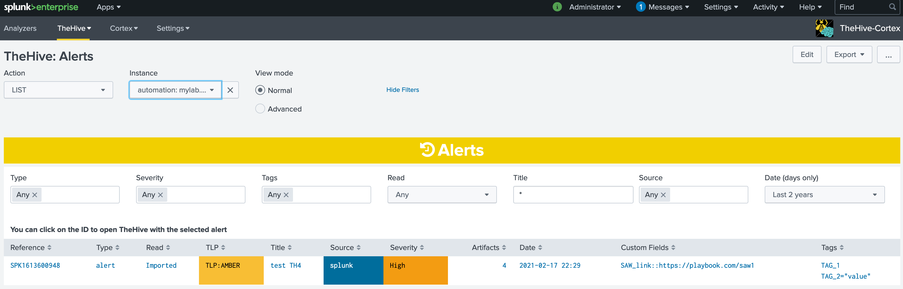
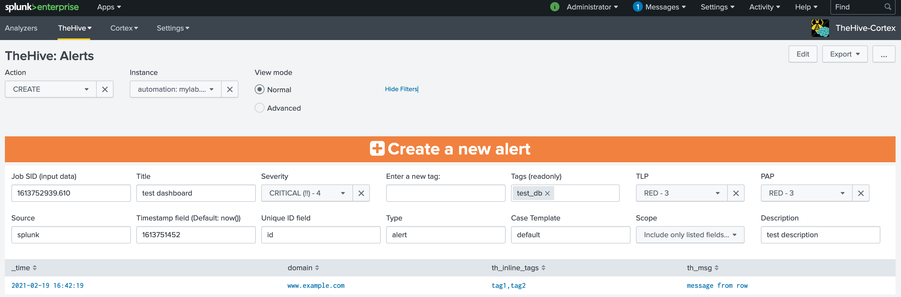
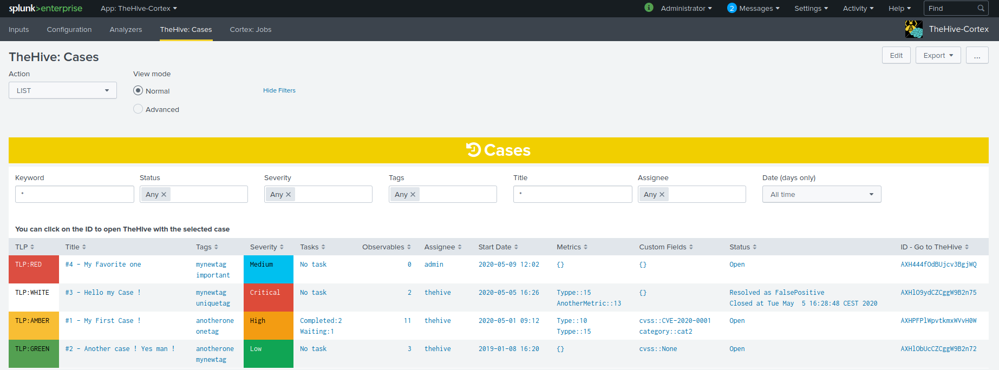
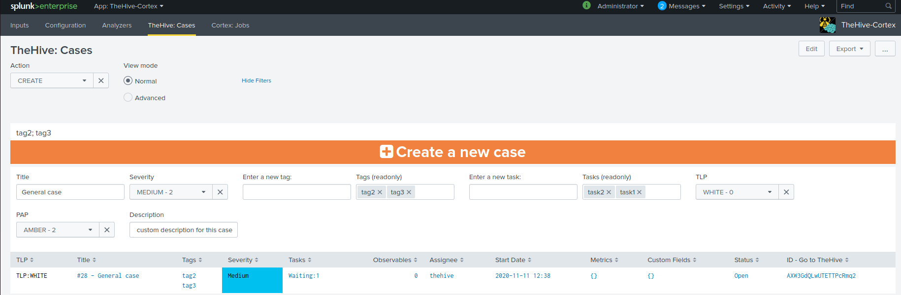
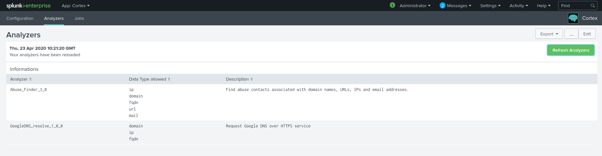

# Dashboards for TheHive

## Alerts

### "TheHive: Alerts" dashboard

The application integrates a preconfigured dashboard with searches allowing you to easily interface with TheHive and manage TheHive alerts.  
This dasboard is also related to alert action "TheHive - Create a new alert"

### TheHive Alert History

You can retrieve the history of alerts in TheHive using the action "LIST".
For each alert, you can see :

- **Alert ID**: ID of the alert
- **Title**: Title of the alert
- **Read**: the status of the alert on TheHive (unread, read, imported)
- **TLP**: TLP of the alert
- **Source**: the set source of the alert (default is "splunk")
- **Severity**: Severity of the alert
- **TTPs**: TTPs of the case (just the number but you can retrieve the full detail in the logs)
- **Observables**: Number of observables for the case (just the number but you can retrieve the full detail in the logs)
- **Date**: date & time of the alert
- **Custom Fields**: custom fields of the alert
- **Tags**: Tags of the alert

You can set filters for the history:

- **Type**: type of alerts
- **Severity**: Severity of alerts
- **Tags**: Tags of alerts
- **Read**: read status of alerts
- **Title**: Title of alerts
- **Source**: source of alerts
- **Date**: Creation date of alerts

### Create a new alert

The standard way is to use the alert action "TheHive - Create a new alert" in your saved Splunk alerts or correlation searches.
You can manually create a new alert from Splunk using the "CREATE" action and a valid SID of a Splunk search.

You have to specify some inputs:

- **Job SID (input data)**: SID of a search (you can retrieve SIDs from Splunk > Activity > Jobs)
- **Title**: Title for this new alert
- **Severity**: Severity for this new alert (default MEDIUM). You can use the field `th_severity` in the search to set the severity value from the results. You can use the following values (values between parenthesis will be processed the same way): [(1,LOW),(2,MEDIUM),(3,HIGH),(4,CRITICAL)]
- **Tags**: Tags for this new alert (they are added by specifiying values in the "Enter a new tag" input)
- **TLP**: TLP for this new alert (default AMBER). You can use the field `th_tlp` in the search to set the TLP value from the results. You can use the following values (values between parenthesis will be processed the same way): [(W,0,WHITE),(G,1,GREEN),(A,2,AMBER),(AS,3,AMBER+STRICT),(R,4,RED)]
- **PAP**: PAP for this new alert (default AMBER). You can use the field `th_pap` in the search to set the PAP value from the results. You can use the following values (values between parenthesis will be processed the same way): [(W,0,WHITE),(G,1,GREEN),(A,2,AMBER),(R,3,RED)]
- **Source**: source of this alert (you can provide a field name to set this value from results)
- **Timestamp field**: field containing a valid EPOCH timestamp (seconds or milliseconds, a fractional part is accepted) - if not present, default to now()
- **Unique ID field**: the unique reference for this alert. If a field name is provided, it is used to group results rows in several alerts - default is SPK+now()
- **Type**: type of alert (default is "alert")
- **Case Template**: Case template to use by default when importing alert into a case
- **Scope**: a swithc to include all fields from result set (as type "other") or only field names listed in lookup table `thehive_datatypes`
- **Description**: Description for this new alert

The search will retrieve the results from SID and create the new alert. You can check the new alert in TheHive Alert History

## Cases

### "TheHive: Cases" dashboard

The application integrates a preconfigured dashboard with searches allowing you to easily interface with TheHive.

#### TheHive Case History

You can retrieve the history of cases in TheHive using the action "LIST".
For each job, you can see :

- **TLP**: TLP of the case
- **Title**: Title of the case
- **Tags**: Tags of the case
- **Severity**: Severity of the case
- **Tasks**: Tasks of the case by status
- **TTPs**: TTPs of the case (just the number but you can retrieve the full detail in the logs)
- **Observables**: Number of observables for the case (just the number but you can retrieve the full detail in the logs)
- **Assignee**: Current assignee for the case
- **Start Date**: Date and time for the start of the case
- **Custom Fields**: Current custom fields for the case
- **Status**: Current status for the case with detailed resolution
- **ID**: ID of the job

**Note: You can click on the ID to view the result of the job directly on TheHive** (you should be authenticated to TheHive)

You can set filters for the history:

- **Keyword**: A keyword to search on
- **Status**: Status of the case
- **Severity**: Severity of the case
- **Tags**: Tags of the case
- **Title**: Title of the case
- **Assignee**: Assignee of the case
- **Date**: Creation date of the case
### Create a new case

The standard way is to use the alert action "TheHive - Create a new case" in your saved Splunk alerts or correlation searches.
You can manually create a new case from Splunk using the "CREATE" action and a valid SID of a Splunk search.

You have to specify some inputs:

- **Job SID (input data)**: SID of a search (you can retrieve SIDs from Splunk > Activity > Jobs)
- **Title**: Title for this new case
- **Severity**: Severity for this new case (default MEDIUM). You can use the field `th_severity` in the search to set the severity value from the results. You can use the following values (values between parenthesis will be processed the same way): [(1,LOW),(2,MEDIUM),(3,HIGH),(4,CRITICAL)]
- **Tags**: Tags for this new case (they are added by specifiying values in the "Enter a new tag" input)
- **TLP**: TLP for this new case (default AMBER). You can use the field `th_tlp` in the search to set the TLP value from the results. You can use the following values (values between parenthesis will be processed the same way): [(W,0,WHITE),(G,1,GREEN),(A,2,AMBER),(AS,3,AMBER+STRICT),(R,4,RED)]
- **PAP**: PAP for this new case (default AMBER). You can use the field `th_pap` in the search to set the PAP value from the results. You can use the following values (values between parenthesis will be processed the same way): [(W,0,WHITE),(G,1,GREEN),(A,2,AMBER),(R,3,RED)]
- **Source**: source of this case (you can provide a field name to set this value from results)
- **Timestamp field**: field containing a valid EPOCH timestamp (seconds or milliseconds, a fractional part is accepted) - if not present, default to now()
- **Unique ID field**: the unique reference for this case. If a field name is provided, it is used to group results rows in several alerts
- **Case Template**: Case template to use by default when importing alert into a case
- **Scope**: a swithc to include all fields from result set (as type "other") or only field names listed in lookup table `thehive_datatypes`

The search will create the new case accordingly

## "TheHive: Statistics" dashboard

Charts the distribution of one field of one TheHive entity — the same as TheHive's own dashboards, through the `thehivegetstats` command. Pick an **Instance**, a **Model** (Alert, Case, Observable, Task, TTP, Audit, …), a **Field** and a period, on the creation or the update date.

# Dashboards for Cortex

## "Cortex: Analyzers" dashboard

Lists the analyzers enabled on a Cortex instance, as Splunk knows them.

- **LIST** reads the `cortex_analyzers` lookup.
- **REFRESH** queries Cortex (`cortexrefreshanalyzers`) and rewrites that lookup. Run it after enabling or disabling an analyzer in Cortex.

## Cortex jobs: from a search

Since v4.0.0 the add-on ships **no Cortex jobs dashboard**: its former "Cortex: Jobs" view did not survive the move to UCC. Jobs are listed and started from a search, with [`cortexjobs`](./commands.md#cortexjobs) and [`cortexrun`](./commands.md#cortexrun), or by an alert with the **Cortex: Run a new job** action.

# Monitoring the add-on

## "Audit Logs" dashboard

Shows what the add-on itself did — modular inputs, alert actions and search commands — from its own logs, through the `` `thehive_cortex_logs` `` macro. It refreshes every 60 seconds. If it stays empty, your role probably cannot search `_internal` (or `cim_modactions`, where Splunk_SA_CIM moves the alert action logs): see [Logging](./installation.md#logging).